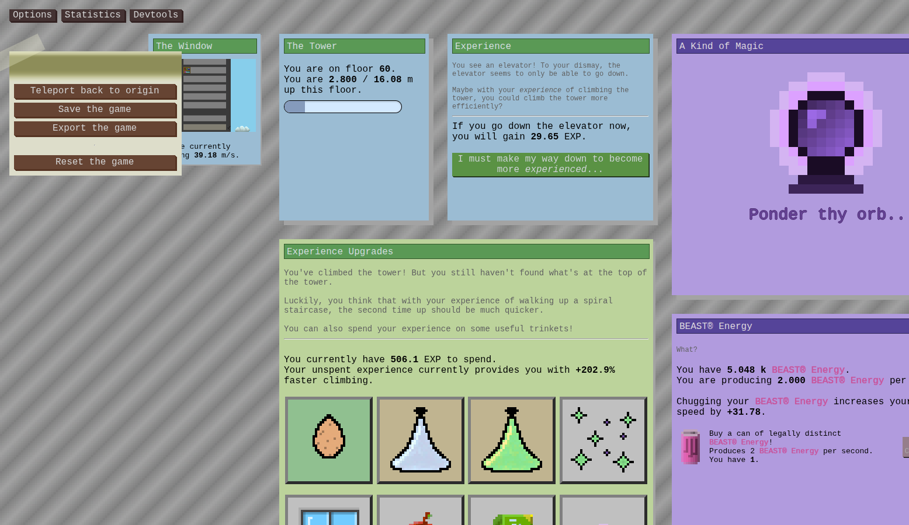

# Tower of Ascension

This was an old game that I had planned on extensively but never bothered to actually build because at the time my skill in HTML and JS were quite limited, and I thought it wouldn't be aesthetically appealing.
Now that I have some more skill, this is a perfect time for me to revive this project.

**This game is made in HTML/CSS/JS**, as a homage to the various idle and incremental games I've played in the past.

The premise of the game is that you climb this huge tower (this is an idle game, after all.) that has various gameplay features unlocked as you reach higher and higher floors.
AS OF THE CURRENT RELEASE, the features implemented are:
- Tower layer:
  - Climb the tower!
  - The progress bar represents your distance to the next floor.
  - You may see an elevator when you go high enough...
- EXP layer:
  - Go back down the tower at floor 10 to reset for EXP
  - EXP boosts your climbing speed
  - You can also spend EXP for useful trinkets and upgrades!
  - Look out the window (unlocked with the Window upgrade) to a scrolling animation of you walking up the tower! (hand drawn by yours truly)
  - Discover an orb...
- Magic Layer
  - Reset your EXP for Magic and Prayers
  - Buy legally distinct cans of BEAST® Energy to chug! (speeds up your final speed)
  - Pray to the pantheon! (Unfortunately our sculpture contractor was a bit late, so as of now all the gods have placeholder images. Expedia wanted to smite the contractor but I told him to give it a bit more time.)

# HOW TO PLAY
ugh why do I have to add this. 

open the tab at https://makerofdopamine.github.io/Tower-of-Ascension to play.

There is no lore. Don't touch the orb. /silly